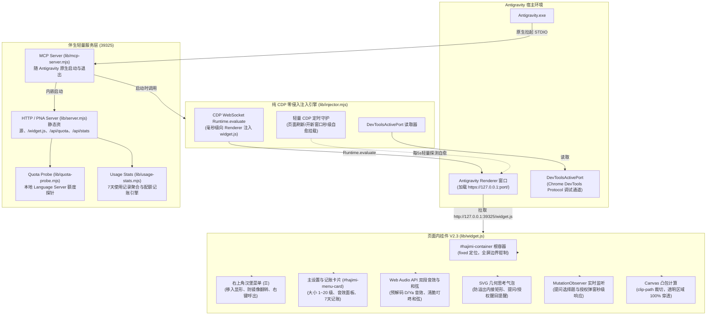

# Antigravity 哈基米页面内挂件与配额监控 (Hajimi Widget V2.3)
## 需求背景、系统架构设计与代码审查白皮书

本文档整理了「Antigravity 哈基米挂件与配额监控系统」V2.3 的完整设计规范、页面内 DOM 注入架构、交互标准、技术亮点以及源文件清单，供后续代码审查（Code Review）与持续维护参考。

---

## 🚨 架构安全核心铁律（P0 级准则）

> [!CAUTION]
> **绝对禁止修改宿主 `app.asar` 任何文件或二进制数据！**
> 1. **Electron Fuses 保护机制**：现代 Electron 应用（包括 Antigravity）具备 `EnableEmbeddedAsarIntegrityValidation` 熔丝防护机制，主进程二进制文件在打包时硬编码了 ASAR Header 的完整性哈希。任何对 `app.asar` 的字节修改，即便内部语法正确，都会直接导致应用在初始化日志前静默退出（Exit Code 1），使软件彻底瘫痪！
> 2. **零侵入与绿色纯净原则**：本项目 **100% 采用 MCP 伴生服务 + CDP (`DevToolsActivePort`) 运行时零侵入页面 DOM 热挂载 + 定时轻量守护机制**。完全不写入、不修改 Antigravity 安装目录的任何系统文件，升级无忧，零风险！

---

## 一、 需求背景与核心目标

### 1. 业务背景与架构转型
- **对标产品**：DeepSeek Harness (DSH) 中的「大肥鱼挂件」（[`MeteorNOX/DeepSeek-Balance-Whale-Widget` (`dsh-whale-widget`)](https://github.com/MeteorNOX/DeepSeek-Balance-Whale-Widget)）。
- **用户核心痛点（V1.0 独立窗口模式的局限）**：
  1. 窗口独立漂浮在操作系统桌面，多显示器或窗口最小化时容易脱节，产生多余的任务栏图标或托盘残留；
  2. 容易被误拖出 Antigravity 软件边界；
  3. 气泡文字尺寸过大，四个角曾捅穿椭圆边框。
- **V2.0 终极目标（方案 A：纯正大肥鱼页面内 DOM 注入模式）**：
  **彻底废除外部独立 Electron 窗口**，让哈基米挂件直接作为 DOM 节点生长在 Antigravity 宿主页面渲染树内部，实现与 Antigravity 视口天然一体、边界无缝钳制、零多余进程与极佳的手感体验。

---

## 二、 V2.0 核心架构与注入引擎设计

系统由 **“MCP 进程生命周期伴生 + CDP 运行时零侵入热注入与自愈守护 + 内嵌 HTTP 静态/配额服务 + 满血 Web Audio 交互”** 构成：

### 1. 纯 CDP 零侵入注入与生命周期守护机制
1. **0 接触、0 侵入、0 破坏**：
   - 绝不改动 `resources/app.asar`，宿主完整性 100% 原生保留；
   - 依赖 Antigravity 原生开启的 Chrome DevTools Protocol 端口（自动从 `AppData/Roaming/Antigravity/DevToolsActivePort` 读取当前调试端口）；
   - 使用 Node.js 原生 `globalThis.WebSocket` 连接 CDP 页面 target，通过 `Runtime.evaluate` 执行安全挂载脚本。
2. **伴生启动与自愈守护**：
   - **随开随伴**：Antigravity 启动会话时，MCP Server（`lib/mcp-server.mjs`）被原生拉起，自动内嵌启动本地 HTTP 服务（端口 39325）；
   - **启动快速重试**：启动初期的前 15 秒内以 1.5 秒步长自动重试注入，等待 Antigravity 渲染页面准备就绪；
   - **页面自愈守护**：`mcp-server.mjs` 开启每 5 秒一次的超轻量 CDP 守护，若页面里已存在 `#hajimi-container` 则评估立即返回 `'already'`（耗时 <1ms，CPU/内存几乎无感）。当用户执行 `Ctrl+R`（Reload Window）刷新页面或开启新的工作区窗口时，挂件在数秒内自动重新挂载！
   - **随退随消**：当 Antigravity 关闭时，STDIO 关闭触发 MCP 进程退出，HTTP 服务与守护定时器彻底销毁，零残留无僵尸。

### 2. PNA 与受信任本地来源（CORS 白名单与防 DNS Rebinding）规范
Antigravity 前端页面运行于 `vscode-file://vscode-app` 或本地环回地址，请求 `http://127.0.0.1:39325` 属于现代浏览器定义的环回私有网络访问。为防御外部网页 CSRF、沙箱 `Origin: null` 绕过及 DNS Rebinding 探测，`lib/server.mjs` 实施严格的 `Host` 与 `Origin` 白名单校验，仅在受信任的本地/宿主来源请求时回显响应头矩阵：
- `Access-Control-Allow-Origin: <受信任的请求 Origin>`（仅允许 `vscode-file://`、`file://`、`antigravity://` 及 `http(s)://127.0.0.1|localhost`，严禁通配符 `*` 与 `null`）
- `Vary: Origin`
- `Access-Control-Allow-Private-Network: true`
- `Access-Control-Allow-Methods: GET, POST, OPTIONS, HEAD`
- `Access-Control-Allow-Headers: Content-Type, Accept`
- `Cross-Origin-Resource-Policy: cross-origin`
所有受信任请求在预检（OPTIONS）时直接返回 204，未授权外部来源直接拦截返回 403。

---

## 三、 满血大肥鱼交互体验规范

### 1. 气泡内额度几何防溢出（消除边框桶穿）
- **椭圆几何**：SVG `viewBox="0 0 1026 700"` 中主椭圆圆心位于 `(454, 247)`，半长轴 `rx = 373`，半短轴 `ry = 232`。
- **安全矩形计算**：
  `.zcwv-text` 精准设置为 `left: 44.25%; top: 35.3%; width: 56%; max-height: 50%; transform: translate(-50%, -50%);`
- **内容呼吸感**：
  三合一进度条紧凑排列（间距 `gap: 14`，高度 `38`），底部倒计时文本紧凑化展示（例如 `Flash 3h55m · Claude 4h55m · Argon 3d23h`），四周保留安全留白，彻底解决捅穿蓝色描边的痛点。
- **纯净视觉呈现（彻底移除 `rua.gif`）**：
  取消历史遗留的摸蓝色大肥鱼动图（`rua.gif`），消除其对气泡内部额度文字的遮挡以及画风冲突；点击哈基米时专注于立绘本身的物理果冻弹性形变（`zcwv-pressing`）、气泡轻弹动画（`nudgeBubble`）与 Web Audio 萌系音效。

### 2. 纯正透明穿透与手感物理
- **零干扰穿透**：
  根容器 `#hajimi-container`、`.zcwv-body`、`.zcwv-pop` 及其 SVG 默认全部应用 `pointer-events: none`；只有在气泡打开状态下内部图形才接收指针；
- **凸包裁剪（Canvas Convex Hull）**：
  通过离屏 Canvas 对 `gemini.png` 不透明像素进行扫描并生成凸包多边形，赋给立绘 `clip-path: polygon(...)`，使立绘周围的透明角落 100% 穿透至底层代码编辑器与输入框，杜绝阻挡点击；
- **Web Audio API 预解码双段音效**：
  预先解码 `D1.mp3`, `D2.mp3`, `Ya1.mp3`, `Ya2.mp3` 为内存中的 `AudioBuffer`；`pointerdown` 同步调用 `createBufferSource().start(0)` 产生贴手零延迟按压音，`pointerup` 顺滑衔接松开音；空闲 60 秒自动 `suspend()`，释放音频设备句柄避免阻碍操作系统睡眠；
- **果冻形变（Squish/Bounce）**：
  按压瞬间实时产生 `scaleY(0.88) scaleX(1.05)` 的压扁形变（带 40ms 极短保底），抬手时通过 `cubic-bezier(.34, 1.56, .64, 1)` 弹性回弹；
- **视口钳制与吸附翻转**：
  拖拽过程使用 `setPointerCapture` 防止脱手，并将坐标实时钳制在可视区 `[0, innerWidth - width]` 与 `[0, innerHeight - height]` 之间；窗口 `resize` 时自愈校正；拖至屏幕左半边自动添加 `.zcwv-left`（`scaleX(-1)`）镜像翻转。

### 3. V2.3 新增模块与交互特性

1. **设置菜单与右键唤出（对标原版大肥鱼图 1）**：
   - 鼠标 Hover 立绘或菜单打开时，右上角浮现 `☰` 汉堡按钮；
   - 支持勾选「隐藏菜单按钮」，在立绘上点击鼠标右键（`contextmenu`）直接呼出/收起设置卡片；
   - 菜单面板与提示弹窗独立挂载于 `document.body`，彻底避免水平翻转带来的反字困扰。
2. **1~20 级滑块 + 数字等比缩放**：
   - 默认 10 档对齐最佳视觉黄金尺寸；
   - 气泡文字、进度条高度全盘基于 `--zcw-u` 单位自适应；
   - 调整大小时以贴靠的屏幕角点为固定锚点，原地平滑缩放不跳动。
3. **边缘磁性吸附（Snap）与翻转开关**：
   - 松手时自动检测立绘距离左/右/下边缘的距离，处于吸附阈值（10% 视口或 80px）内时产生丝滑的磁性贴边吸附过渡；
   - 提供「开启吸附」与「开启翻转」独立开关，满足不同使用偏好。
4. **音效与提示设置面板（对标原版大肥鱼图 2）**：
   - 全部音效总控、按压音效选择（默认音效 / 小黄鸭音效）及音量滑块（0% ~ 100%）；
   - 提问提示与授权提示独立开关，采用 Web Audio 合成清脆灵动的双音和弦。
5. **提问与授权 DOM 实时监听（`MutationObserver`）**：
   - 零延迟监听 Antigravity 原生 `ask_question` 选择题与工具执行授权弹窗；
   - 出现时猫猫 Q 弹跳跃，自动切换为醒目提醒气泡并播放提示音，用户处理后自动恢复。
6. **哈基米记账（近 7 天使用记录，对标原版大肥鱼图 3）**：
   - 后端 `lib/usage-stats.mjs` 极速聚合 `~/.gemini/antigravity/brain/` 真实日志；
   - 精确展示今日 Token 消耗、交互步数、会话数以及三大配额池累计消耗百分比；
   - 列表展示过去 7 天每天的 Token 与步数明细。

---

## 四、 核心代码结构与文件清单

工作区与全局插件目录保持 **100% 双向同步**：
- 工作区：`./`
- 全局插件：`~/.gemini/config/plugins/antigravity-hajimi-widget/`

| 相对路径 | 模块类型 | 核心职责 |
| :--- | :--- | :--- |
| [`mcp_config.json`](./mcp_config.json) | 配置 | 注册 `hajimi-quota` MCP 服务入口。 |
| [`plugin.json`](./plugin.json) | 配置 | 声明插件元数据（V2.3.0 页面内挂件）。 |
| [`hooks.json`](./hooks.json) | 配置 | 注册 `SessionStart` 钩子，调用全局绝对路径的 `hook-session-start.cjs`。 |
| [`lib/injector.mjs`](./lib/injector.mjs) | 核心引擎 | **纯 CDP 零侵入热注入引擎**。通过 DevToolsActivePort 实现免改安装包的 WebSocket DOM 注入与守护。 |
| [`lib/widget.js`](./lib/widget.js) | 前端运行时 | **V2.3 满血挂件**。SVG 气泡、1~20级缩放、磁性吸附、汉堡菜单、音效面板、DOM提醒、7天记账。 |
| [`lib/usage-stats.mjs`](./lib/usage-stats.mjs) | 后端引擎 | **7天使用记录与配额记账引擎**。遍历本地 brain 日志，聚合 Token、步数、会话并追踪 Δ% 配额。 |
| [`lib/server.mjs`](./lib/server.mjs) | 本地服务 | 轻量静态资源服务与配额代理，提供 `/api/quota` 与 `/api/stats` 接口。 |
| [`lib/mcp-server.mjs`](./lib/mcp-server.mjs) | MCP 服务 | 随 Antigravity 生命周期自动拉起与退出，内嵌 HTTP 服务并执行纯 CDP 注入与守护。 |
| [`lib/hook-session-start.cjs`](./lib/hook-session-start.cjs) | 钩子处理器 | 会话开始时毫秒级异步触发 CDP 挂件挂载。 |
| [`lib/quota-probe.mjs`](./lib/quota-probe.mjs) | 额度探测 | 对接 Antigravity 本地 Language Server RPC 获取精确模型配额与重置时间。 |
| [`skills/hajimi-quota/SKILL.md`](./skills/hajimi-quota/SKILL.md) | 技能声明 | 为 Antigravity 智能体提供配额查询与挂件唤醒技能。 |
| [`assets/gemini.png`](./assets/gemini.png) | 静态资产 | 哈基米立绘图片。 |
| [`assets/D1.mp3`](./assets/D1.mp3) 等 | 静态资产 | 经典双段萌系音效。 |

---

## 五、 验收标准与验证矩阵 (DoD)

1. [x] **页面内单一进程**：不再弹出独立 Electron 窗口，无任务栏图标、无系统托盘图标；
2. [x] **零重启纯 CDP 热生效**：通过 CDP WebSocket 成功注入当前正在运行的 Antigravity 渲染窗口，免重启、免改文件；
3. [x] **零侵入与 100% 稳定性保障**：**绝不修改 `app.asar`**，不破坏 Electron Fuses，主进程 100% 稳定启动；
4. [x] **自动自愈守护**：MCP 服务提供轻量 CDP 定时守护，页面 Reload（`Ctrl+R`）或新开工作区窗口数秒内自动挂载挂件；
5. [x] **防溢出与美观**：文字区域严格约束在椭圆几何安全区内，不捅穿边框；
6. [x] **穿透体验**：透明区域 100% 穿透，不阻挡底层代码编辑；
7. [x] **音画同步**：Web Audio API 预解码双段音效，果冻回弹丝滑，静默 60 秒自动挂起；
8. [x] **工程一致性**：工作区与全局插件目录全部文件 100% 双向同步。
